<p align="center"></p>
<h1 align="center">Docker Scan</h1>
<p align="center"><strong>Scan filesystem directory for Dockerfiles and create metadata output.</strong></p>
<p align="center">Turn a directory tree into image and group records without contacting a Docker daemon.</p>
<p align="center">
  <a href="https://www.npmjs.com/package/docker-scan"></a>
  <a href="https://github.com/tada5hi/docker-scan/actions"></a>
  <a href="LICENSE"></a>
</p>
<p align="center"><a href="#installation">Installation</a> · <a href="#usage">Usage</a> · <a href="#api">API</a> · <a href="#notes">Notes</a></p>

---

## Why Docker Scan?

Turn a directory tree into image and group records without contacting a Docker daemon.

| Concern | Without it | With it |
|---|---|---|
| Discovery | Write a recursive filesystem walk | Recognize Dockerfile and metadata directories |
| Grouping | Track parent group IDs yourself | Attach nearest group and virtual path |
| Metadata | Load descriptors separately | Read image.json and image-group.json during scanning |

Docker Scan checks image.json first, then image-group.json, then Dockerfile. Images stop recursion; groups and unclassified directories recurse into child directories.


## Installation

```bash
npm install docker-scan
```

Requires Node `>=20.0.0`. ESM, CommonJS and TypeScript declarations are included. Import the documented package entrypoint rather than undeclared `dist/` paths.

## Usage

```typescript
import { scanDirectory } from 'docker-scan';

const result = await scanDirectory('./images');
for (const image of result.images) {
    console.log(image.id, image.path, image.virtualPath, image.groupId);
}
console.log(result.groups);
```

## Directory metadata

```text
images/
  services/
    image-group.json
    api/
      Dockerfile
      image.json
```

`image-group.json` can contain `{ "id": "services", "name": "Services" }`. `image.json` can contain `{ "id": "api", "name": "API" }`. Additional descriptor fields are retained in the result, but scanner-derived `path`, `virtualPath` and group association take precedence.

| Input | Meaning |
|---|---|
| `image.json` | Image descriptor; name defaults to directory name |
| `image-group.json` | Group descriptor; ID and name default to directory name |
| `Dockerfile` | Image without a descriptor; ID and name use directory name |
| `ScanOptions.path` | Initial relative filesystem path |
| `ScanOptions.virtualPath` | Initial virtual parent path |
| `ScanOptions.groupId` | Initial parent group ID |

When supplying options, include both `path` and `virtualPath`. Omit the whole object for the default empty prefixes.

## API

All names below are exported from `docker-scan`. Types have no runtime value.

| Export | Kind | Purpose |
|---|---|---|
| `detectMetaTypeOfDirectory` | function | Detect readable image or group descriptors |
| `readImageMeta` | function | Load an image descriptor with default name/path |
| `readGroupMeta` | function | Load a group descriptor with default ID/name |
| `MetaType` | enum | Image and group categories |
| `MetaFileName` | enum | image.json and image-group.json filenames |
| `ImageMeta` | type | Type contract for image meta |
| `GroupMeta` | type | Type contract for group meta |
| `scanDirectory` | function | Discover image and group directories recursively |
| `Group` | type | Type contract for group |
| `Image` | type | Type contract for image |
| `ScanResult` | type | Type contract for scan result |
| `ScanOptions` | type | Type contract for scan options |

## Notes

- **Images are leaves.** Once a directory is recognized as an image, scanning returns that image without traversing its children. Group and ordinary directories are traversed.
- **Descriptor precedence.** A readable `image.json` wins over `image-group.json`; a group descriptor wins over a bare `Dockerfile`. An image descriptor does not require a Dockerfile.
- **Not a Docker validator.** Scanning does not build images, parse Dockerfile instructions or verify that an image can run. Invalid descriptor content or filesystem errors can reject the scan.
- **Options are mutable.** A supplied `ScanOptions` object is updated when a group is encountered. Supply a fresh object for independent calls.
- **Path meaning.** `path` is relative to the scan root, using host separators. `virtualPath` joins group IDs and image IDs with `/`; image IDs fall back to directory names.

## Contributing

Use the verified development commands in [the agent guide](AGENTS.md).

## License

Made with 💚

Published under the [MIT License](LICENSE).
